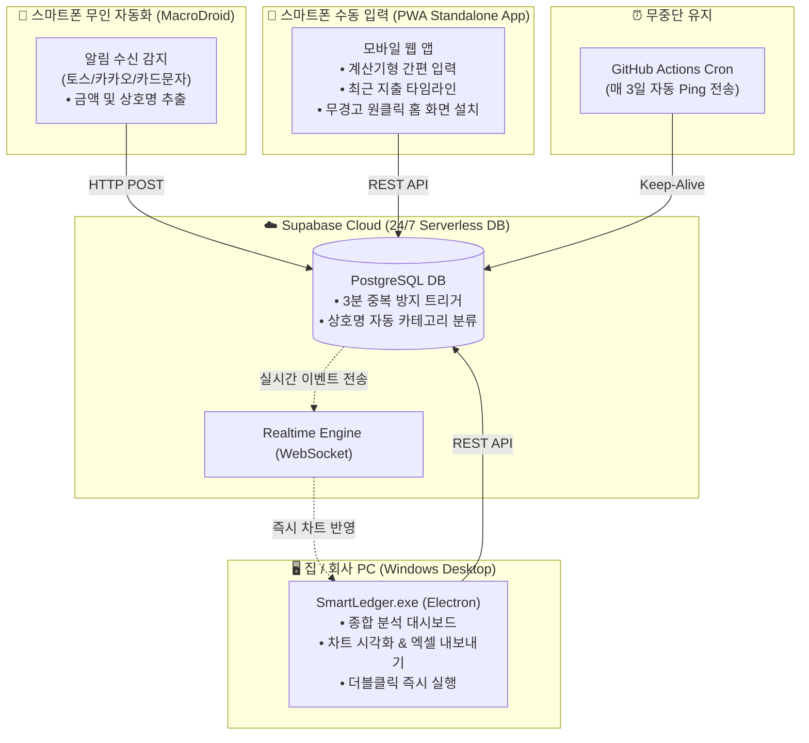

# 💰 스마트 원격 가계부 (Smart Ledger)


> **24시간 무중단 실시간 연동 스마트 가계부 시스템**  
> 집 PC 서버를 켤 필요 없이, **스마트폰 무인 자동 등록**, **PWA 모바일 앱**, **PC 윈도우 포터블 실행 파일** 어디서나 실시간으로 동기화되어 사용할 수 있는 개인 가계부입니다.

---

## ⚡ 바로가기 및 다운로드

| 구분 | 링크 | 설명 |
| :--- | :--- | :--- |
| **📱 스마트폰 PWA 앱 접속** | **[https://myunghwank1m.github.io/smart-ledger/](https://myunghwank1m.github.io/smart-ledger/)** | **보안 경고 0건**, 브라우저 접속 후 [홈 화면에 추가] 시 전체화면 앱으로 설치 |
| **🖥️ PC용 실행 프로그램** | **[SmartLedger.exe 다운로드 (v1.0.2)](https://github.com/MyungHwanK1m/smart-ledger/releases/download/v1.0.2/SmartLedger.exe)** | 설치 불필요, 다운로드 후 더블클릭 즉시 실행 (Windows 64-bit, 신규 전용 아이콘 적용) |
| **🤖 무인 자동화 가이드** | **[MacroDroid 설정 가이드](./MACRODROID_GUIDE.md)** | 토스/카드 알림 수신 시 폰 안 켜도 자동 등록 (3분 중복 제거 포함) |
| **📦 GitHub 통합 릴리즈** | **[GitHub Releases](https://github.com/MyungHwanK1m/smart-ledger/releases)** | 최신 릴리즈 및 파일 배포 내역 |
| **☁️ Supabase 콘솔** | **[Supabase Project Console](https://supabase.com/dashboard/project/uyafrivmhhyzicbnkhet)** | 가계부 클라우드 데이터베이스 콘솔 |

---

## ✨ 핵심 기능

* **🤖 무인 자동 결제 등록 (MacroDroid):**
  * 결제 알림(토스, 카카오페이, 카드 승인 문자) 도착 시 **폰을 켜지 않아도 0.1초 만에 DB 자동 적재**
  * **3분 타임 윈도우 중복 방지:** 토스 알림과 카드사 문자가 동시 도착해도 1건만 깔끔히 저장
  * **상호명 기반 자동 카테고리 매핑:** 스타벅스/메가커피→카페, 배민/식당→식비, CU/GS25→편의점/마트 자동 분류
* **📱 모바일 3초 간편 수동 입력 (PWA):**
  * 계산기형 전용 숫자 키패드 및 `+1만`, `+5만`, `+10만` 퀵 버튼
  * 토스, 카카오페이, 신용카드, 체크카드, 계좌이체, 현금 원터치 결제수단 선택
  * 일별/최근 내역 타임라인 피드
* **🖥️ PC 종합 분석 대시보드 (Desktop):**
  * **상단 KPI 4종:** 이번 달 총 지출, 총 수입, 순 잔액, 목표 예산 사용률 프로그레스 바
  * **카테고리별 소비 분석:** Recharts 인터랙티브 도넛 차트 및 지출 랭킹
  * **일별 소비 추이:** 일자별 지출/수입 바 차트 (소비 집중일 파악)
  * **전체 거래내역 테이블:** 다중 필터(유형, 결제수단), 검색, 수정/삭제, **엑셀(CSV) 내보내기**
* **⚡ 초고속 실시간(Realtime) 동기화:**
  * 스마트폰에서 지출을 등록하는 즉시, 켜져 있는 PC 프로그램 화면에 새로고침 없이 1초 만에 그래프와 통계가 자동 갱신됩니다.
* **🔒 로컬 보안 PIN 잠금:**
  * 4자리 숫자 PIN 번호 잠금 기능으로 개인 금융 데이터 보호.
* **⏰ 7일 미사용 자동 일시정지(Pause) 방지:**
  * Supabase 무료 티어의 7일 미사용 수면 정책을 방지하기 위해, GitHub Actions가 매 3일마다 자동으로 핑을 보내 24시간 365일 무중단 유지.

---

## 🛠️ 시스템 아키텍처



---

## 💻 개발 및 빌드 명령어

Node.js 환경에서 직접 소스코드를 빌드하거나 실행할 때 사용합니다:

```bash
# 1. 저장소 클론 및 패키지 설치
git clone https://github.com/MyungHwanK1m/smart-ledger.git
cd smart-ledger
npm install

# 2. 로컬 개발 서버 실행
npm run dev

# 3. 웹 및 PWA 프로덕션 빌드
npm run build

# 4. Windows 포터블 EXE 파일 빌드
npm run build:exe
```

---

## 🗄️ 데이터베이스 스키마 및 트리거 (Supabase SQL)

1. **기본 스키마:** [`schema.sql`](./schema.sql) - 테이블 및 기본 15종 카테고리 생성
2. **자동화 스키마:** [`schema_automation.sql`](./schema_automation.sql) - 3분 중복 방지 및 상호명 자동 카테고리 분류 트리거
