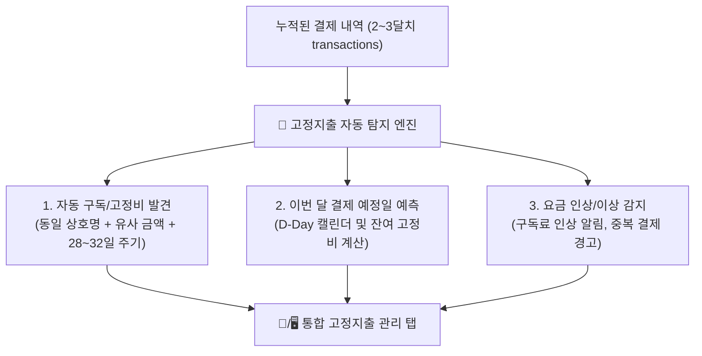

# 📋 [로드맵] 몇 달 치 가계부 기반 고정지출 / 정기구독 자동 분석 시스템 기획안

> **목적:**  
> 스마트 가계부에 몇 달 동안 결제 데이터가 쌓였을 때, 사용자가 일일이 수동 등록하지 않아도 **알고리즘이 자동으로 고정지출(넷플릭스, 통신비, 관리비, 보험료 등)을 감지하고 분석해 주는 지능형 시스템**을 구축하기 위한 사전 설계서입니다.

---

## 1. 핵심 기능 및 가치



1. **🤖 무인 고정지출 자동 탐지 (Auto-Detection):**
   * 매달 비슷한 날짜(±3일), 동일/유사 상호명, 동일 금액으로 발생하는 거래를 백그라운드에서 자동 분석.
   * 예: *"최근 3개월간 매달 15일경 '넷플릭스(17,000원)' 결제가 감지되었습니다. 고정지출로 등록할까요? [등록]"*
2. **📅 결제 예정일 D-Day 캘린더:**
   * *"이번 달 앞으로 나갈 예정 고정지출: 324,000원 (D-3 쿠팡와우, D-7 통신비)"*
   * 통장 잔고 부족으로 인한 연체/미납 방지.
3. **📊 고정지출 vs 변동지출 황금 비율 분석:**
   * 전체 지출 중 숨만 쉬어도 나가는 돈(고정비) 비율을 한눈에 파악하여 저축 가능 여력 진단.
4. **⚠️ 요금 인상 감지 (Price Hike Alert):**
   * 예: 지난달 유튜브 프리미엄 10,450원 ➡️ 이번 달 14,900원 결제 시 *"구독료 인상 감지"* 태그 표시.

---

## 2. 고정지출 탐지 알고리즘 로직

PostgreSQL 함수 또는 프론트엔드 분석 엔진에서 아래 3가지 조건을 결합하여 판별합니다:

| 분석 요소 | 판별 기준 | 예시 |
| :--- | :--- | :--- |
| **상호명 유사도** | 상호명이 일치하거나 핵심 키워드 일치 | `넷플릭스`, `SKT`, `현대해상`, `아파트관리비` |
| **결제 주기성** | 최근 결제일 간의 차이가 **28일 ~ 32일** (또는 주간 단위 7일) | 매월 14일, 15일, 14일 반복 |
| **금액 일치도** | 금액이 100% 동일하거나 **오차율 ±5% 이내** (통신비/관리비 등 소폭 변동 반영) | 68,400원 ➡️ 69,100원 |
| **최소 반복 횟수** | 최소 **2회 이상** 연속 결제 발생 시 후보군 선정 | 2달 이상 연속 감지 |

---

## 3. 데이터베이스 스키마 확장 계획 (Supabase)

기존 테이블 구조를 손상시키지 않고 독립된 테이블과 뷰를 추가하여 완벽한 Zero-Invasion 원칙을 준수합니다.

```sql
-- 고정지출 / 정기구독 관리 테이블
create table if not exists public.recurring_expenses (
    id uuid default gen_random_uuid() primary key,
    name text not null,                    -- 예: '넷플릭스 프리미엄'
    expected_amount integer not null,      -- 예상 결제 금액
    billing_day integer not null check (billing_day between 1 and 31), -- 매월 결제일 (1~31)
    category_id uuid references public.categories(id) on delete set null,
    category_name text not null default '기타지출',
    payment_method text not null default '카드',
    is_active boolean default true,        -- 현재 구독/유지 중인지 여부
    auto_detected boolean default false,   -- 알고리즘이 자동 탐지했는지 여부
    last_charged_at timestamptz,          -- 마지막 결제 일시
    created_at timestamptz default now()
);

-- RLS 정책 설정 (공개 조회/수정)
alter table public.recurring_expenses enable row level security;
create policy "Allow all recurring" on public.recurring_expenses for all using (true) with check (true);
```

---

## 4. UI/UX 화면 구성 기획

### ① PC 종합 대시보드 (`DesktopDashboard.tsx`)
* **상단 요약 배너:**
  * `이번 달 고정지출 총액: 435,000원` | `남은 결제 예정: 2건 (82,000원)` | `지출 중 고정비 비중: 38%`
* **고정지출 목록 & D-Day 리스트:**
  * 결제일이 가까운 순서대로 정렬 (D-1, D-4 등 뱃지 표시)
  * 일시 정지(구독 해지) 토글 버튼 제공
* **지출 구성 도넛 차트:**
  * [고정지출 (주거/통신/구독/보험)] vs [변동지출 (식비/카페/쇼핑/여가)]

### ② 모바일 화면 (`MobileRecentFeed.tsx`)
* 상단 스와이프 카드 형태로 `다가오는 결제 예정 D-Day` 미니 칩 표시
* 한 번의 탭으로 이번 달 결제 완료 여부 체크

---

## 5. 단계별 구현 로드맵 (실행 시점 가이드)

| 단계 | 추진 시기 | 세부 작업 내용 |
| :--- | :--- | :--- |
| **Phase 1 (준비기)** | **현재 ~ 2달 후** | • 현재 구축된 자동/수동 가계부로 일상 결제 데이터 축적<br>• MacroDroid 무인 자동화로 결제 데이터 무손실 수집 |
| **Phase 2 (개발기)** | **데이터 2~3달 누적 시** | • Supabase에 `recurring_expenses` 테이블 및 패턴 분석 SQL 쿼리 추가<br>• 최근 90일 내역 대상 고정지출 자동 추천 알고리즘 작성 |
| **Phase 3 (UI 적용)** | **기능 완성 시** | • PC 대시보드 및 모바일 화면에 '고정지출 관리' 탭 & 위젯 추가<br>• 결제 예정일 D-Day 캘린더 컴포넌트 릴리즈 |
| **Phase 4 (배포)** | **최종 릴리즈** | • GitHub Pages 및 `SmartLedger.exe` v2.0 정식 배포 |
